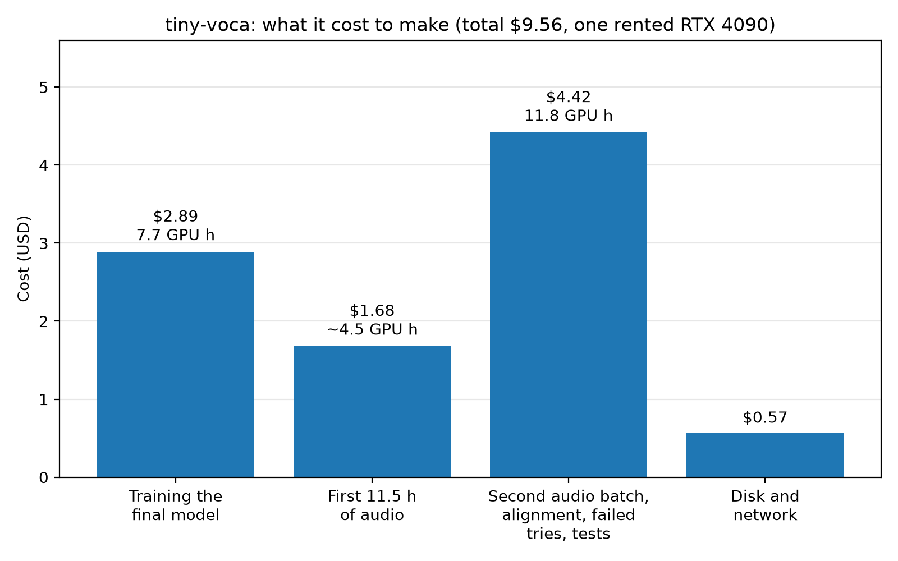

# tiny-voca

tiny-voca is a small English text-to-speech model. It has two voices, 4.5M
parameters, and runs on a CPU or in the browser.

[Demo](https://tiny-voca.n4ze3m.com) · [Weights](https://huggingface.co/n4ze3m/tiny-voca) · [Dataset](https://huggingface.co/datasets/n4ze3m/tiny-voca)

## Features

- **Small**: 4,537,291 parameters, 18 MB, waveform generator included.
- **Fast**: about 70x real time on four CPU threads.
- **Two voices**: F2 (female) and M2 (male), American English, 24 kHz.
- **Runs anywhere**: PyTorch, ONNX Runtime, and ONNX Runtime Web.
- **Open**: code, weights, training recipe and dataset. Trained from scratch.

## Install

```bash
git clone https://github.com/n4ze3m/tiny-voca.git
cd tiny-voca
pip install -e ".[own]"
hf download n4ze3m/tiny-voca --local-dir weights
export DIZIONE_DATA=weights/phonemizer
```

## Usage

```bash
python -m tiny_voca.infer \
  --checkpoint weights/tiny-voca.pt \
  --voice F2 \
  --text "Hello! This is tiny voca." \
  --output hello.wav
```

| Option | Default | Meaning |
|---|---|---|
| `--text-file` | | Read the text from a file instead of `--text` |
| `--voice` | `F2` | `F2` or `M2` |
| `--speed` | 1.0 | Speaking rate |
| `--pitch-shift` | 0 | Raise or lower the pitch |
| `--pitch-range` | 1.0 | More or less pitch movement |

Long text is fine. It is read one sentence at a time and the audio is joined.
A text that ends without a mark gets a full stop, so the last word does not
break off. A sentence with nothing to read, such as one in another script, is
skipped. The output never peaks above 0.99, so it does not clip as a 16-bit
WAV. In Python, `tiny_voca.infer.speak_text` does the same.

## ONNX

```bash
python -m tiny_voca.export --checkpoint weights/tiny-voca.pt --output tiny-voca.onnx
```

A ready file is in the weights repository as `onnx/model.onnx`. The
[model card](https://huggingface.co/n4ze3m/tiny-voca) shows how to call it.

## Web demo

The [demo](https://tiny-voca.n4ze3m.com) runs the model in the browser. It
plays each sentence as soon as it is made, and keeps the whole clip in the
player. Its source is in `web/`.

```bash
cd web
bash fetch_assets.sh /path/to/dizione
npx wrangler dev
```

## Training

```bash
export TINY_VOCA_FRONTEND=own
python -m tiny_voca.prepare --inputs data/train-*.parquet --split train --output features
python -m tiny_voca.annotate --features features --output annotations
python -m tiny_voca.train --train annotations/train.jsonl --validation annotations/validation.jsonl \
  --output runs/NAME --steps 104000 --gan-start 8000 --gan-ratio 0.7 --teacher-final 0
python -m tiny_voca.evaluate --checkpoint runs/NAME/inference.pt --annotations annotations --output eval/NAME
```

The released weights took 7.7 hours on one RTX 4090. More about the model and
the data is in [docs/model.md](docs/model.md).

## Tests

```bash
PYTHONPATH=src:tests python -m unittest discover -s tests
```

## Limits

- English only. Two fixed voices. No voice cloning.
- The F2 voice sounds younger than intended. A more mature voice is planned.
- Foreign names and odd spellings are often read wrong.
- No streaming yet.

## Cost

The whole project cost $9.56 of GPU time on one rented RTX 4090. That is the
dataset, the failed tries and the final training run.



## Support

It cost less than a pizza to make. If you like it, you can buy me one:
https://ko-fi.com/n4ze3m

## License

Apache-2.0 for code and weights. CC BY 4.0 for the dataset.

## Citation

```bibtex
@software{nazeem2026tinyvoca,
  author = {Nazeem, Muhammed},
  title  = {tiny-voca: a 4.5M-parameter two-voice English text-to-speech model},
  year   = {2026},
  url    = {https://huggingface.co/n4ze3m/tiny-voca}
}
```
