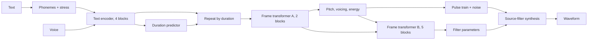

# Model and data

## Model

The text encoder and the two frame-level transformers use pre-norm blocks with
rotary position embeddings (192 channels, 4 heads). Durations, pitch, voicing
and energy are predicted explicitly, as in FastSpeech 2.

The waveform is produced by a source-filter synthesizer instead of a neural
vocoder. A band-limited pulse train at the predicted pitch and a noise signal
are each shaped by a time-varying filter, whose cepstrum the network predicts
once per frame (hop 256 samples, 10.7 ms). This part has 25,862 parameters.

| Component | Parameters |
|---|---:|
| Embeddings (phoneme, stress, voice) | 16,704 |
| Text encoder | 1,588,864 |
| Duration and pause predictor | 123,906 |
| Frame transformer A, prosody head | 795,971 |
| Frame transformer B | 1,985,984 |
| Source-filter waveform head | 25,862 |
| Total at inference | 4,537,291 |

Two modules exist only during training: an auxiliary mel head (15,440
parameters) and the waveform discriminators (2,675,312).

## Data

The training audio is synthetic. Both voices were created from text
descriptions with Qwen3-TTS VoiceDesign, and all recordings were generated with
Qwen3-TTS 1.7B Base using those two reference clips. No recording of a real
speaker is involved. Each clip was screened with Whisper small.en and rejected
above 15% word error rate.

| Split | Clips | Hours |
|---|---:|---:|
| Train | 16,018 | 17.6 |
| Validation | 714 | |
| Test | 594 | |

The dataset has 17,371 clips (19.1 hours) in two batches. The first batch
reads LibriTTS-R transcripts (CC BY 4.0) and sentences written for this project
with an LLM. The second batch, training data only, reads Mozilla Common Voice
sentences (CC0) and project templates covering numbers, dates, money, names and
questions.

Phoneme durations come from forced alignment with
`facebook/wav2vec2-lv-60-espeak-cv-ft`. The aligner is used only to label the
training data. The annotation format is described in
[annotations-v3.md](annotations-v3.md).

## Training

Training has two phases: spectral losses only for the first 8,000 steps, then
an added adversarial loss with multi-period and multi-resolution
discriminators. The released checkpoint was trained for 104,737 steps on one
RTX 4090, 7.7 hours in total: 66,000 steps on the first batch with eSpeak NG
phonemes, then 38,737 steps on both batches with dizione phonemes.

## Evaluation

Word error rate of synthesized speech, transcribed with Whisper small.en.

| Sentences | Clips | WER, tiny-voca | WER, recordings |
|---|---:|---:|---:|
| Validation | 8 | 0.6% | 0.6% |
| Test | 8 | 0.9% | 0.9% |
| New sentences, not in the dataset | 16 | 0.0% | |

These sets are small and the scores are a sanity check, not a benchmark.

## Third-party components

dizione (Apache-2.0; its dictionary comes from CMUdict), Qwen3-TTS
(Apache-2.0, used to generate the training audio),
`facebook/wav2vec2-lv-60-espeak-cv-ft` (Apache-2.0, alignment only), Whisper
(MIT, screening and evaluation only), LibriTTS-R transcripts (CC BY 4.0) and
Mozilla Common Voice sentences (CC0). Checkpoints up to step 66,000 used
eSpeak NG (GPL-3.0) as an external program; the released one does not.

The design builds on FastSpeech 2, DDSP and the neural homomorphic vocoder,
and HiFi-GAN and UnivNet. No code or weights from these projects are used.
